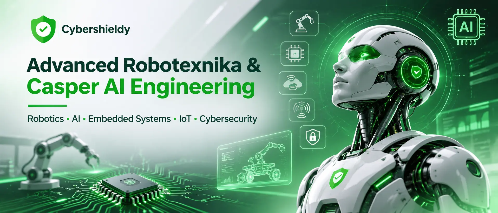
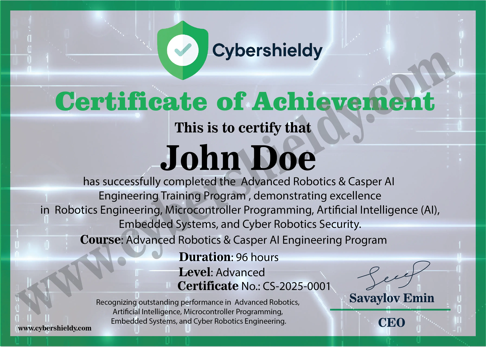

# 🤖 Advanced Robotexnika, Süni İntellekt və Casper AI Kursu

### Robotun yalnız hərəkətini deyil, onun **beynini, proqramını, sensorlarını və təhlükəsizlik sistemini** özün qur!
**CyberShieldy Academy** tərəfindən təqdim edilən **Advanced Robotexnika & Casper AI Engineering** təlimi sadə robot yığımı ilə məhdudlaşmayan, **mikrokontroller, embedded systems, süni intellekt, IoT, kompüter görməsi, robot avtomatikası və kibertəhlükəsizliyi** birləşdirən layihə əsaslı tədris konseptidir.

Bu kursun əsas ideyası hazır robotu idarə etmək deyil — **robotu sıfırdan layihələndirmək, onun elektronik sistemini qurmaq, proqramını yazmaq, internet və sensorlarla əlaqələndirmək, AI funksiyaları əlavə etmək və təhlükəsiz işləməsini təmin etməkdir.**

👨‍🏫 **Təlimçi və layihələrin müəllifi:** **Emin Savaylov** — CyberShieldy Academy, Cybersecurity Red Team & Blue Team təlimçisi, **Casper AI** robot və təhlükəsizlik laboratoriya layihələrinin müəllifi.  

🧠 **Səviyyə:** Advanced / layihə yönümlü (əsas proqramlaşdırma və elektronika biliyi tövsiyə olunur)  

🔧 **Format:** Real cihazlar, kodlaşdırma, test, diaqnostika və prototipləmə  

🌐 **İstiqamətlər:** Robotics • AI • Embedded Systems • IoT • Cybersecurity  

📍 **Tədris imkanları:** Format, cədvəl və iştirak şərtləri qeydiyyat zamanı dəqiqləşdirilir.  

🏆 **Nəticə:** İşlək robot prototipi, GitHub layihəsi, texniki sənədləşmə və təqdimat üçün portfolio.

---
## 🚀 Kursun fəlsəfəsi — ROBOT + BRAIN + AI + SECURITY
Bir çox başlanğıc robotexnika dərslərində robot sadəcə xətt izləyir və ya uzaqdan idarə olunur. **Casper AI konseptində** isə daha böyük sistem qurulur:

1. **Body — Mexanika və hərəkət:** servomotor, DC motor, pan–tilt, sürücü və enerji.

2. **Senses — Sensorlar:** məsafə, RFID, barmaq izi, kamera, toxunma, EMG və digər siqnallar.

3. **Brain — Embedded logic:** ESP32/ESP32-S3, mikrocontroller firmware, real-time qərar mexanizmi.

4. **Intelligence — AI:** səs komandaları, obyekt tanıma, qayda əsaslı qərarlar və AI xidmətləri ilə inteqrasiya.

5. **Connectivity — IoT:** Wi-Fi, MQTT, REST API, server, dashboard və mobil cihaz inteqrasiyası.

6. **Defense — Security:** autentifikasiya, icazələr, loglama, audit, təhlükəsiz idarəetmə və anomaliya xəbərdarlıqları.

**Məqsəd:** Elektronika + kod + robot + AI + təhlükəsizlik sahələrini ayrı-ayrı deyil, bir-biri ilə işləyən **vahid mühəndislik sistemi** kimi mənimsəmək.

---
## ⭐ Bu kursu fərqləndirən nədir?
- ✅ **Yalnız nəzəriyyə yox:** real ESP32 lövhələri və sensorlarla laboratoriya işləri.

- ✅ **Robotun beynini özün proqramlaşdır:** firmware, hadisələr, state machine və avtomatlaşdırma.

- ✅ **Casper AI yanaşması:** səs, vizual siqnallar, sensor reaksiyası və server əsaslı idarəetmə.

- ✅ **Cyber + Robotics:** IoT və embedded təhlükəsizliyi, etik hardware security testləri.

- ✅ **Kompüterdən fiziki dünyaya:** Python API → ESP32 → motor/sensor → cavab → log.

- ✅ **Mühəndislik portfolion:** sxem, kod, test hesabatı, demo video və final layihəsi.

- ✅ **Modul layihələri:** hər mərhələdə işləyən konkret funksiyanın hazırlanması.

---
## 🧭 Tam Roadmap — Advanced Robotics & Casper AI Engineering
### 🔹 Modul 1: Embedded Systems və mikrokontroller arxitekturası
- Mikrocontroller və single-board computer fərqi: ESP32, ESP32-S3, ESP8266, Raspberry Pi Pico, Raspberry Pi.

- CPU, RAM, Flash, GPIO, ADC, PWM, UART, SPI, I²C, interrupt, watchdog və enerji rejimləri.

- Arduino IDE, PlatformIO, C/C++ və MicroPython; Git ilə versiya idarəetməsi.

- Datasheet oxuma, pinout, firmware flash və serial monitor diaqnostikası.

- Modullar arasında məlumat axını və düzgün arxitektura seçimi.

🧩 **Mini Project:** “ESP32 Smart Control Core” — status, sensor oxunuşu və idarəetmə interfeysi.

### 🔹 Modul 2: Elektronika, enerji və təhlükəsiz sxem qurulması
- Gərginlik, cərəyan, müqavimət, multimetrlə ölçmə və siqnal səviyyələri.

- 3.3 V / 5 V məntiq səviyyələri, level shifting və ümumi GND konsepti.

- Servo və motor üçün ayrıca qidalanma, buck converter, rele, MOSFET, qoruyucu elementlər.

- Breadboard, lehimləmə, konnektorlar, PCB əsasları və korpus dizaynı.

- Enerji büdcəsi, qızma, qısaqapanma və reverse polarity riskləri.

🧩 **Mini Project:** “Safe Robot Power Unit” — qorunan enerji və aktuator modulu.

### 🔹 Modul 3: Robot mexanikası, motor və hərəkət idarəetməsi
- Servo, DC motor və motor driver (L298N və alternativlər).

- Pan–tilt mexanizmi, bucaq limitləri, kalibrasiya və PWM siqnalları.

- Joystick ilə manual/auto rejim, limit switch və təhlükəsiz dayanma.

- Hərəkət ardıcıllığı, state machine, sadə PID anlayışı.

- Robotun başı, gözü, qolu və mobil platforması üçün modulyar dizayn.

🧩 **Project:** “Casper AI Robotic Head” — istiqamətlənən baş və idarəetmə rejimləri.

### 🔹 Modul 4: Sensor fusion — robot ətrafı necə hiss edir?
- HC-SR04 ultrasəs məsafə ölçümü və filtrasiya.

- TTP229 toxunma klaviaturası, joystick, RFID RC522, PN532 və barmaq izi sensoru.

- ADC siqnal oxuma, noise reduction, debouncing və hadisə aşkarlanması.

- EMG kimi siqnallarla yalnız uyğun izolyasiyalı, təhlükəsiz, bədənə qoşulma üçün nəzərdə tutulmuş avadanlıqdan istifadə prinsipləri.

- Çoxsaylı sensordan gələn nəticələrin qayda əsaslı birləşdirilməsi.

🧩 **Project:** “Sensor-Aware Casper” — sensor siqnallarına görə reaksiyalar.

### 🔹 Modul 5: Robotun vizual sistemi və ekranda AI xarakteri
- SSD1306 OLED və ILI9341 TFT interfeysləri.

- Robot gözü: iris, bəbək, göz qırpma və istiqamət animasiyaları.

- Hadisəyə görə emosional/veb status göstəriciləri.

- Frame update, performans, SPI resursları və animasiya optimallaşdırması.

🧩 **Project:** “Casper Digital Eyes” — hərəkətə və hadisələrə reaksiya verən robot gözləri.

### 🔹 Modul 6: Robot proqramlaşdırması — Brain Architecture
- C/C++ ilə firmware modulları, siniflər, sürücülər və təhlükəsiz konfiqurasiya.

- Non-blocking kod, timers, queue, interrupts və ESP32 FreeRTOS əsasları.

- Sensor → qərar → aktuator hadisə xətti.

- Finite State Machine (FSM), fail-safe rejim və watchdog.

- Test edilən komponentlər, debugging və telemetriya.

🧩 **Project:** “Casper Brain v1” — modulyar qərar və hərəkət sistemi.

### 🔹 Modul 7: Wi-Fi, IoT, API və serverlə robot idarəetməsi
- Wi-Fi şəbəkəsi, MQTT, HTTP/REST, JSON və WebSocket konseptləri.

- ESP32 ↔ Python/FastAPI və ya Flask ↔ mobil/veb interfeys.

- Sensor məlumatlarının serverə göndərilməsi və əmrlərin robotda icrası.

- Local-first arxitektura, bağlantı qopduqda təhlükəsiz davranış.

- Dashboard, strukturlaşdırılmış log və hadisə tarixçəsi.

🧩 **Project:** “Casper IoT Command Center” — veb paneldən real vaxt idarəetməsi.

### 🔹 Modul 8: Süni intellekt və səs ilə idarəetmə
- AI və rule-based sistem fərqi; nəyi mikrokontroller, nəyi server yerinə yetirməlidir?

- Speech-to-Text, Text-to-Speech və səs əmrlərinin emalı.

- Azərbaycan dilində komanda axını üçün prototipləmə.

- Python vasitəsilə AI xidmətləri və robot funksiyaları arasında körpü.

- İcazə verilən əmrlər siyahısı, yanlış tanıma zamanı təsdiq və təhlükəsiz icra.

- Lokal AI imkanları, bulud xidmətlərinin məhdudiyyətləri və məxfilik.

🧩 **Project:** “Casper Voice Assistant” — səs komandası ilə robotun göz, baş və status modullarının idarəsi.

### 🔹 Modul 9: Computer Vision və ağıllı müşahidə
- ESP32-CAM, kamera interfeysləri, OpenCV və görüntü emalına giriş.

- Obyektin aşkarlanması, hərəkət aşkarlanması və vizual hadisə analizi.

- Kamera kadrının serverdə işlənməsi və nəticənin ESP32-yə qaytarılması.

- Vizual izləmə ilə pan–tilt reaksiya sistemi.

- Gizlilik, razılıq və görüntülərin təhlükəsiz saxlanması.

🧩 **Project:** “Casper Vision Lab” — obyekt/hərəkət aşkarlanması ilə başın reaksiya verməsi.

### 🔹 Modul 10: RFID, fingerprint və Smart Access Robot
- RFID/NFC texnologiyaları və autentifikasiya məhdudiyyətləri.

- Barmaq izi sensoru ilə qeydiyyat, yoxlama və giriş qərarı.

- Relay və elektromaqnit qıfılın qorunan idarəetmə arxitekturası.

- İcazə verilən/verilməyən giriş hadisələrinin qeydiyyatı.

- Anti-replay prinsipləri, default-deny və manual emergency override.

🧩 **Project:** “Casper Smart Access Control” — RFID + fingerprint + səsli bildiriş + audit.

### 🔹 Modul 11: Ethical Hardware Hacking və IoT Security
- Yalnız **öz cihazların və icazəli, təcrid edilmiş laboratoriya** mühitində təhlükəsizlik testləri.

- UART, I²C və SPI trafikinin diaqnostikası; firmware və debug interfeysləri.

- IoT threat modeling, secure boot/flash encryption prinsipləri, sirlərin qorunması.

- Wi-Fi/BLE bağlantılarında autentifikasiya, şifrələmə və məxfilik.

- RFID sistemlərinin təhlükə modelləri və müdafiə mexanizmləri.

- USB HID risklərinin təhlili və yalnız təsdiq edilmiş demo avtomatlaşdırması.

- Loglama, anomaliya aşkarlanması, Wazuh/Splunk/SIEM ilə konseptual inteqrasiya.

- İcazəsiz radio siqnalı yayımı, şəbəkəyə müdaxilə və üçüncü şəxslərin cihazlarında test yoxdur.

🧩 **Project:** “IoT Device Security Audit” — öz robotunun təhlükəsizlik yoxlaması və düzəliş hesabatı.

### 🔹 Modul 12: Robotun infrastruktur beyni — Linux, server və avtomatlaşdırma
- Linux və Python servis arxitekturası; robot üçün backend.

- Docker ilə lokaldakı xidmətləri ayırma, API və webhook axınları.

- Hadisə qaydaları, n8n tipli workflow və Telegram bildirişlərinin layihələndirilməsi.

- Məlumatın saxlanması, audit, monitorinq və səhv olduqda bərpa strategiyası.

- İstəyə bağlı inteqrasiya: SIEM məlumatları əsasında robotun ekran/səs xəbərdarlığı.

🧩 **Project:** “Casper Cyber Alert Robot” — təhlükəsizlik hadisəsinə fiziki və səsli reaksiya.

### 🔹 Modul 13: Robotun uzaqdan idarə olunması və interfeys mühəndisliyi
- Mobil panel, brauzer və lokal şəbəkədən idarəetmə.

- Joystick, touch input və serial komanda interfeysləri.

- Əmr prioritetləri, səlahiyyətlər, timeout və emergency stop.

- Geri əlaqə: kamera, sensor statusu və aktuator mövqeyi.

🧩 **Project:** “Casper Multi-Control Hub” — joystick + veb + səs üçlüyü.

### 🔹 Modul 14: Sistem inteqrasiyası, test və mühəndislik təqdimatı
- Sxem və blok diaqramı, BOM (hissə siyahısı), GitHub README.

- Firmware, backend, dashboard və AI modullarının inteqrasiya testləri.

- Sensor səhvi, internet kəsintisi, enerji problemi və fail-safe testləri.

- Demo videosu, texniki hesabat və məhsul prototipinin təqdimatı.

🧩 **Final Project:** “CASPER AI — SMART ROBOTIC SECURITY ASSISTANT”.

---
## 🦾 Casper AI — təlimdə nümunə kimi istifadə edilə bilən müəllif layihələri
**Casper AI** konsepti robotexnika, süni intellekt və kibertəhlükəsizlik ideyalarını eyni ekosistemdə birləşdirir. Aşağıdakılar ayrı-ayrı prototiplər və laboratoriya istiqamətləridir; onların hamısının vahid, hazır məhsul olduğu iddia edilmir.

\| Layihə | Texnologiyalar | Nümayiş etdirilən bacarıq |

\|---|---|---|

\| **Casper Robotic Head** | ESP32, servo, joystick, PWM | Baş hərəkəti, kalibrasiya və manual/auto rejim |

\| **Casper Digital Eyes** | ESP32-S3, TFT ILI9341 | Robotun vizual ifadəsi və ekran animasiyası |

\| **Casper Voice Control** | Python, Android TTS, HTTP API | Səs və serverlə robot idarəetməsi |

\| **Casper Smart Access** | RC522, fingerprint, relay | RFID, biometrik yoxlama və giriş logları |

\| **Casper Sensor Lab** | HC-SR04, EMG, TTP229 | Sensorlardan siqnal və hadisə emalı |

\| **Casper IoT Bridge** | ESP32, Wi-Fi, JSON, Python | Robot–server arasında məlumat mübadiləsi |

\| **Casper Cyber Alert** | SIEM hadisələri, webhook, səs/display | Təhlükəsizlik bildirişlərinin robotda əks olunması |

\| **Casper Hardware Security Lab** | ESP32, UART/SPI/I²C, HID demo | Embedded sistemlərin etik təhlükəsizlik təhlili |

\> **Casper AI tək bir robot deyil — sensorlar, mikrokontrollerlər, AI modulları, serverlər və təhlükəsizlik laboratoriyalarını birləşdirən mühəndislik konseptidir.**

---
## 🧰 Tədrisdə istifadə oluna bilən cihaz və texnologiyalar
**Mikrokontrollerlər:** ESP32-WROOM, ESP32-S3, ESP8266 NodeMCU, Raspberry Pi Pico, M5StickC Plus 2, M5Cardputer.  

**Giriş/identifikasiya:** RC522 RFID, PN532 NFC, fingerprint modulları, keypad.  

**Sensorlar:** HC-SR04, joystick, TTP229, uyğun EMG sensor interfeysləri.  

**Hərəkət:** servo, DC motor, motor driver, pan–tilt modulları.  

**Ekran və səs:** ILI9341 TFT, SSD1306 OLED, DFPlayer Mini, buzzer.  

**Server və AI:** Python, Linux, REST API, JSON, MQTT, computer vision və səs texnologiyaları.  

**Hardware security:** logic analyzer, serial terminal, izolyasiya edilmiş IoT lab və icazəli test cihazları.

**Avadanlıq siyahısı layihəyə görə dəyişir; hər tələbənin bütün modulları satın alması tələb olunmur. Komponentlərin mövcudluğu və xərcləri qeydiyyatdan əvvəl dəqiqləşdirilməlidir.**

---
## 🎯 Kimlər üçün nəzərdə tutulub?
- ESP32/Arduino ilə baza səviyyəsində işləyib daha ciddi robot sistemi qurmaq istəyənlər.

- C/C++ və Python bacarıqlarını fiziki cihazlarda tətbiq etmək istəyən proqramçılar.

- AI, computer vision və səsli köməkçini real robotla birləşdirmək istəyənlər.

- IoT və embedded security sahəsində ixtisaslaşmaq istəyən kibertəhlükəsizlik mütəxəssisləri.

- Öz **robot prototipini, smart security cihazını və ya AI-assisted automation** sistemini yaratmaq istəyən mühəndislər.

**Hazırlıq tövsiyəsi:** Sadə elektronika, proqramlaşdırma məntiqi və kompüter/şəbəkə əsasları. Bilik fərqləri üçün giriş təkrarı nəzərdə tutula bilər, lakin əsas tədris **qabaqcıl səviyyəyə** yönəlib.

---
## 🏁 Kurs sonunda nə bacaracaqsan?
1. Mikrokontroller üçün strukturlaşdırılmış firmware yazmaq və debug etmək.

2. Servo, motor, sensor, displey və enerji hissələrini təhlükəsiz inteqrasiya etmək.

3. Robot üçün **brain/controller** arxitekturası və qərar mexanizmi yaratmaq.

4. Python serveri və API ilə robotu idarə etmək.

5. Robotun səs, vizual və sensor reaksiyalarını AI imkanları ilə birləşdirmək.

6. IoT cihazları üçün təhlükə modeli, giriş nəzarəti və audit logları qurmaq.

7. Prototipin sxemini, kodunu, test hesabatını və portfoliolarını təqdim etmək.

**Portfolio layihəsi:** Kod deposu + bağlantı sxemi + cihaz siyahısı + demo videosu + təhlükəsizlik/test hesabatı.

---
## 👨‍🏫 Müəllif və təlimçi — Emin Savaylov
**Emin Savaylov** — **CyberShieldy Academy** çərçivəsində kibertəhlükəsizlik üzrə **Red Team & Blue Team təlimçisi**, **Casper AI robotexnika və kiber laboratoriya layihələrinin müəllifi**.

Tədris yanaşmasının mərkəzində hazır kodu kopyalamaq deyil, sistemin necə işlədiyini anlamaq dayanır: **sensor siqnalı haradan gəlir, firmware necə qərar verir, AI hansı hissədə işləyir, məlumat serverə necə gedir və bütün bu sistem necə təhlükəsiz saxlanılır?**

Bu kursda robotexnika, embedded proqramlaşdırma və cybersecurity bir-birini tamamlayan praktiki mühəndislik istiqamətləri kimi təqdim edilir.

**Müəllif konsepti:** **“Robotu hərəkət etdirmək başlanğıcdır. Əsl mühəndislik onun beynini proqramlaşdırmaq, hiss etməsini təmin etmək, qərar verməsini qurmaq və bütün sistemi təhlükəsiz idarə etməkdir.”

---
## 🏆 Robotexnika Kursu Sertifikatı
Kursun yekun qiymətləndirməsi və sertifikatlaşdırma şərtləri qeydiyyat zamanı dəqiqləşdirilir. Aşağıdakı bölmə **CyberShieldy Academy — Casper AI Robotexnika** sertifikatının nümunə şəklini yerləşdirmək üçündür.

---
## ❓ Tez-tez verilən suallar (FAQ)
### 1️⃣ Bu, adi Arduino robotexnika kursudur?
**Xeyr.** Tədris robotun komponentlərini öyrənməklə yanaşı firmware arxitekturası, Python backend, AI inteqrasiyası, IoT və embedded security sahələrinə fokuslanır.

### 2️⃣ Sıfırdan iştirak edə bilərəm?
Bu proqram **əsasən advanced səviyyəlidir**. Başlanğıc biliyi olmayan iştirakçıya əvvəlcə proqramlaşdırma və elektronika bazası toplamaq tövsiyə olunur.

### 3️⃣ Kursda real robot hazırlanır?
Tədris konsepti **işlək prototiplər və yekun robot layihəsi** üzərində qurulub. Konkret konstruksiya iştirakçının seçdiyi layihəyə, avadanlığa və dərs planına görə dəyişə bilər.

### 4️⃣ AI robotun özündə işləyir, yoxsa serverdə?
Hər iki arxitektura öyrədilir. Yüngül qərar məntiqi ESP32 üzərində, daha ağır səs və görüntü emalı isə uyğun hallarda Linux/Python serverində və ya ayrıca AI xidmətində işləyə bilər.

### 5️⃣ Hardware hacking öyrədiləcək?
**Bəli, etik və müdafiə məqsədli laboratoriya formatında.** Öz cihazlarında firmware, debug interfeysləri, protokol analizi, zəifliklərin qiymətləndirilməsi və qorunma üsulları öyrədilir.

### 6️⃣ Bütün cihazları əvvəlcədən almalıyam?
Xeyr. Avadanlıq siyahısı seçilən layihəyə uyğun ayrıca müəyyən edilir.

### 7️⃣ Kursun müddəti və qiyməti nə qədərdir?
Müddət, dərs qrafiki, qrup ölçüsü, qiymət və mümkün sertifikat şərtləri **qeydiyyat zamanı** dəqiqləşdirilir.

---
## 🔎 Robotexnika, Kiber Robot və AI Kursu — Azərbaycan üzrə Axtarış İstiqamətləri
**Robotexnika kursu Azərbaycanda** axtaranlar üçün bu proqram robot yığımı ilə yanaşı **robotun beyninin proqramlaşdırılması, ESP32 və Arduino ilə elektronika, süni intellekt inteqrasiyası və robot təhlükəsizliyi** mövzularını birləşdirir. **Bakı robotexnika kursu**, **robot proqramlaşdırma kursu** və **advanced robotics kursu** ilə maraqlananlar layihə əsaslı tədris konsepti ilə tanış ola bilərlər.

**Kiber robot kursu** və **AI robot kursu** istiqamətində Casper AI konsepti səsli idarəetmə, sensorlarla qərarvermə, computer vision, IoT bağlantısı, Python serveri, mikrocontroller firmware və təhlükəsizlik monitorinqini əhatə edir.

**Kibertəhlükəsizlik kursu, ethical hacking kursu, hacker kursu və hardware hacking kursu** ilə maraqlananlar üçün robot və IoT cihazlarının **yalnız icazəli laboratoriya mühitində** təhlükəsizlik təhlili, interfeys auditləri, autentifikasiya və müdafiə mexanizmləri nəzərdə tutulur. Bu robotexnika proqramı ayrıca ümumi pentest təlimini əvəz etmir; kiber bacarıqları fiziki qurğulara tətbiq edir.

### Əsas mövzular və SEO açar ifadələri
- **Robotexnika və robototexnika:** robotexnika kursu, robototexnika kursları, Bakı robot dərsləri, robot hazırlama, qabaqcıl robot mühəndisliyi, robot proqramlaşdırma.

- **Kiber robot və hacking:** kiber robot kursu, kiber robotexnika, etik hacking kursu, hardware hacking, IoT hacking, embedded security, kiber təhlükəsizlik kursu Azərbaycan.

- **AI və avtomatlaşdırma:** süni intellekt robotu, AI robot beyni, Casper AI, səsli robot idarəetmə, computer vision, sensor fusion, ağıllı sistemlər.

- **Elektronika və embedded proqramlaşdırma:** ESP32, ESP32-S3, Arduino, Raspberry Pi Pico, mikrokontroller kursu, C/C++, MicroPython, robot firmware, RFID və servo idarəetmə.

- **Praktiki layihələr:** Casper AI Robotic Head, Digital Eyes, Voice Control, Smart Access, Cyber Alert Robot, AI Security Assistant.

---
## 🌐 Qeydiyyat və Əlaqə
📲 [WhatsApp ilə robotexnika kursu barədə yaz](https://wa.me/994555182523?text=Salam%2C%20Advanced%20Robotexnika%20ve%20Casper%20AI%20kursu%20haqqinda%20melumat%20almaq%20isteyirem.)  

🌍 [CyberShieldy rəsmi sayt](https://cybershieldy.com/)  

🛡️ [Kiber Təhlükəsizlik kursu](https://cybershieldy.com/kiber-tehlukesizlik-kursu/)  

💡 [Təlimçi haqqında](https://cybershieldy.com/haqqinda/)

**🤖 Casper AI — Build the Brain. Program the Future. Secure the Robot.**

---
<!-- SEO Structured Data: Course -->


