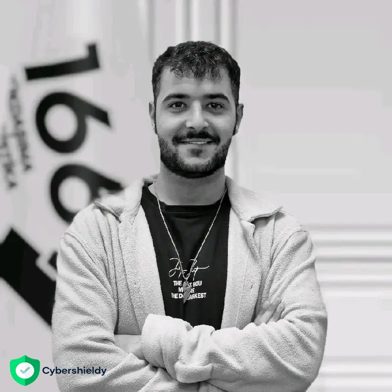
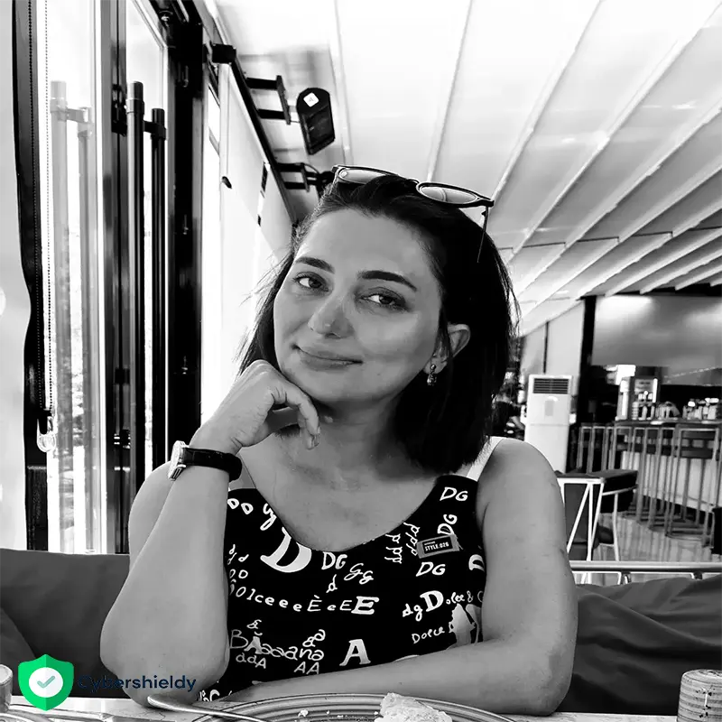
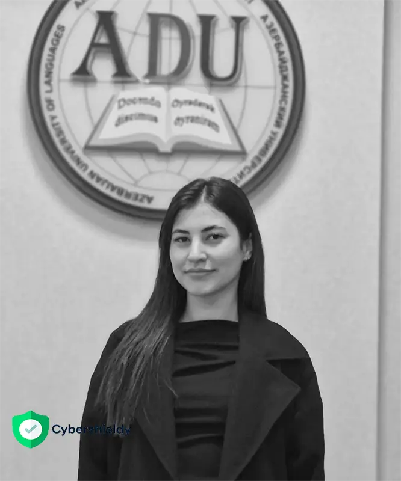
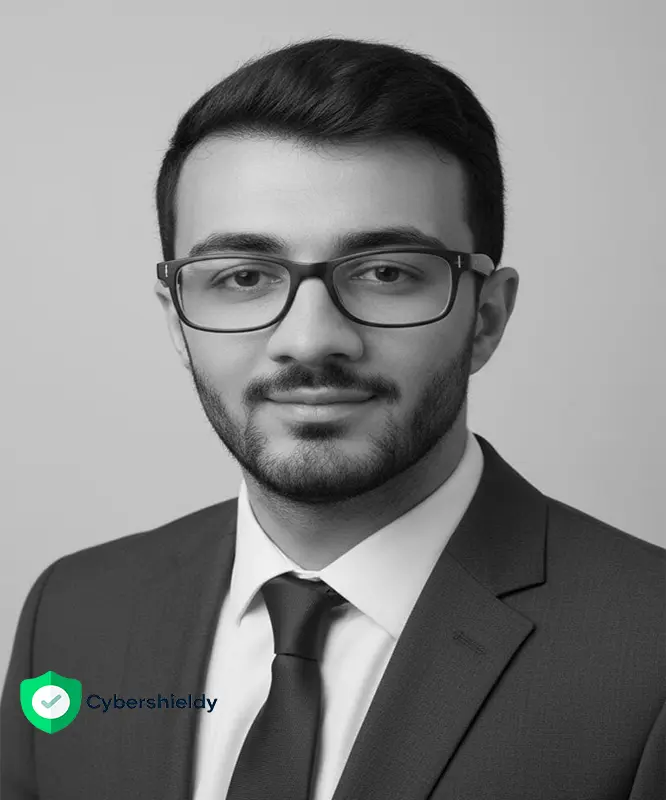

# 🎓 Tələbə Nailiyyətləri

Bu səhifədə <strong>kurslarımızı uğurla bitirən tələbələrin</strong> real uğurları, ixtisasları və peşəkar bacarıqları təqdim olunur.  
Onlar artıq <strong>IT və Kiber Təhlükəsizlik sahəsində</strong> aktiv fəaliyyət göstərirlər. 🚀

---

  <!-- 🧑‍🎓 1-ci tələbə - Nərmin -->
  

    

    

      <h3 style="font-weight: 700; margin-bottom: 5px;">Nərmin Əsədullayeva Sarvan qızı</h3>
      
<strong>Kiber Təhlükəsizlik</strong> 
      Tətbiqi Riyaziyyat və Kibernetika fakültəsi, Kompüter elmləri ixtisası, IV kurs tələbəsi

      
Texnoloji yeniliklərə marağı olan və analitik düşünmə qabiliyyətinə malik gənc mütəxəssisdir. Kibertəhlükəsizlik və Full Stack Web Development sahələrində ixtisaslaşıb. Praktiki layihələrdə iştirak edib və müasir texnoloji platformalarla intensiv təcrübəyə malikdir.

      
Rus və ingilis dillərini sərbəst bilir, komandada və müstəqil şəkildə effektiv işləyir. Beynəlxalq səviyyədə tanınan <strong>CompTIA</strong> sertifikatına malikdir. İnnovativ düşüncə, məsuliyyət və mükəmməlliyə canatma prinsipləri ilə fəaliyyət göstərir.

    

  

  <!-- 👨‍💻 2-ci tələbə - Azad -->
  

    

    

      <h3 style="font-weight: 700; margin-bottom: 5px;">Azad</h3>
      
<strong>Full Stack Developer</strong>

      
2 ildən artıqdır ki, Full Stack Developer olaraq fəaliyyət göstərir. Kod yazmağı sevir, xətaları inkişaf üçün fürsət hesab edir və daim öyrənməyə can atır. Proqramlaşdırmanı yalnız texniki sahə deyil, həm də yaradıcılıq vasitəsi hesab edir.

      
Frontend və backend texnologiyalarında yüksək səviyyəli təcrübəyə malikdir. HTML, CSS, JavaScript, React, Node.js və SQL bazalarında işləyir. Komanda işinə açıqdır, innovativ həllər axtarır və real layihələrdə aktiv iştirak edir.

      
Texnoloji yenilikləri izləyərək öz biliklərini daim yeniləyir. Hədəfi beynəlxalq səviyyədə tanınan sertifikasiyalarla ixtisaslaşmış bir mütəxəssis olmaqdır.

    

  

  <!-- 👩‍💻 3-cü tələbə - Əfsanə -->
  

    

    

      <h3 style="font-weight: 700; margin-bottom: 5px;">Əfsanə Məmmədli</h3>
      
<strong>Kiber Təhlükəsizlik</strong>

      
Əfsanə Məmmədli – tədqiqatçı, media analitik. Akademik və əmək fəaliyyətim boyu daim yeniliklərlə açıq olmuşam. Çağdaş dövrümüzdə yeni texnologiyaların həyatımıza yaxından nüfuz etməsi ilə bu sahə ilə daha yaxından maraqlanmağa başladım.

      
Təsadüflər məni Emin Savaylovun kiber təhlükəsizlik kursuna gətirib çıxardı. Bir illik dərs boyunca Emin müəllimin çox asan, anlaşıqlı tədris metodları sayəsində bu sahədə biliklərimi dərinləşdirdim, müxtəlif əməliyyatları sərbəst şəkildə icra etməyə başladım. Hazırda Google şirkətinin təsis etdiyi xüsusi kiber təhlükəsizlik kursuna davam edirəm. Onu da qeyd etməliyəm ki, Emin müəllimin dərslərində keçilənlər mənə Google kursundakı mövzuları çox asanlaşdırdı.

      
Düşünürəm ki, bu günkü süni zəka dövründə ixtisasından asılı olmayaraq hər kəs bu sahədə biliklərə yiyələnməli, dünyagörüşünü genişləndirməlidir. Bunu ən asan şəkildə Emin müəllimin kurslarında çağdaş tədris metodları ilə əldə etmək mümkündür.

    

  

  <!-- 👩‍💻 4-cü tələbə - Günel -->
  

    

    

      <h3 style="font-weight: 700; margin-bottom: 5px;">Günel Hüseynova</h3>
      
<strong>Kiber Təhlükəsizlik</strong>

      
My name is Günel Huseynova. I completed my Bachelor's degree in German Language and Literature Teaching at Azerbaijan University of Languages, graduating with honors and a high GPA. Although my academic background is in languages, I have always been very interested in technology. This interest inspired me to start learning cybersecurity and to build my career in this field.

      
Cybersecurity is a fast-growing field that constantly requires new knowledge. It is not only about protecting technology, but also plays an important role in the global economy, digital society, and international collaboration. I am very interested in developing practical skills and understanding real-world attack and defense scenarios.

      
During my studies, I gained knowledge in areas such as analyzing cyber attacks, network security principles, system defense, and working with security tools. Through practical exercises, I developed skills in penetration testing, SOC operations, vulnerability assessment, and security monitoring.

      
I want to turn my interest and efforts into practical skills and start my career as a junior pentester or SOC analyst. In the future, I aim to grow as a Cloud Security specialist, experienced pentester, or even Chief Information Security Officer (CISO). For me, cybersecurity is not just a career — it is a meaningful opportunity to innovate, solve complex problems, and make the digital world safer.

    

  

  <!-- 👩‍💻 5-ci tələbə - Günel -->
  

    

    

      <h3 style="font-weight: 700; margin-bottom: 5px;">Ayxan Abbasov
</h3>
      
<strong>Kiber Təhlükəsizlik</strong>

      
Mən Ayxan Abbasovam. Bakü şəhərində yaşayıram və Azərbaycan Texniki Universitetində Kompüter Elmləri ixtisası üzrə bakalavr təhsilimi başa vurdum. Təhsilim ərzində həm nəzəri, həm də praktiki biliklər əldə etdim və kibertəhlükəsizlik sahəsinə xüsusi maraq göstərdim. Bu marağım məni həm universitet layihələrində, həm də şəxsi öyrənmə yolu ilə kibertəhlükəsizlik üzrə əlavə hazırlıq keçməyə sövq etdi.

      Kibertəhlükəsizlik yalnız texnologiyanı qorumaq deyil, həm də müasir rəqəmsal cəmiyyətin, iqtisadiyyatın və milli təhlükəsizliyin ayrılmaz bir hissəsidir. Kibertəhlükəsizlik sahəsindəki bilik yolculuğum Emin Savaylovun rəhbərlik etdiyi xüsusi kursla daha da dərinləşdi və burada praktiki bacarıqlarımı inkişaf etdirmək fürsəti əldə etdim. Bu sahədə daim yenilənən bilik və bacarıqlar tələb olunur. Mən də özümü şəbəkə təhlükəsizliyi, məlumatların qorunması, penetrasiya testləri və sosial mühəndislik kimi istiqamətlərdə inkişaf etdirirəm.

      
Təhsilim və kurslarım çərçivəsində kiberhücumların təhlili, təhlükəsizlik protokolları, açıqlıqların qiymətləndirilməsi, həmçinin müxtəlif təhlükəsizlik alətləri ilə işləməyi öyrəndim. Praktiki məşğələlər və təcrübə proqramları vasitəsilə də penetrasiya testlərinin əsasları, SOC prosesləri və təhlükəsizlik monitorinqi bacarıqlarımı möhkəmləndirdim.

      Məqsədim kibertəhlükəsizlik sahəsində etik haker və ya SOC analisti kimi karyerama başlamaq, sonrakı mərhələlərdə isə bulud təhlükəsizliyi mütəxəssisi və ya Kibertəhlükəsizlik üzrə Rəhbər (CISO) kimi inkişaf etməkdir. Kibertəhlükəsizlik mənim üçün yalnız peşə deyil, həm də mürəkkəb problemləri həll etmək, öyrənmək və təhlükəsiz rəqəmsal gələcəyə töhfə vermək fürsətidir.

      
    

  

  
<!-- 👩‍💻 Tələbə - Rahmatova Narmin Faiq -->

  

  

    <h3 style="font-weight: 700; margin-bottom: 5px;">
      Rahmatova Narmin Faiq
    </h3>

    
<strong>🎓 Azerbaijan State University of Economics (UNEC)</strong>

    
<strong>🛡️ Cybersecurity | Red Team & Blue Team | Practical Cybersecurity Training</strong>

    

      My name is Narmin Rahmatova, and I am a student at Azerbaijan State University of Economics (UNEC). My journey into cybersecurity began from the very beginning, with a strong desire to understand how computer systems, networks, cyber attacks, and digital defense technologies work.
    

    

      Under the mentorship of <strong>Emin Savaylov</strong>, a cybersecurity specialist and Red Team & Blue Team instructor, I completed a comprehensive, practice-oriented cybersecurity training program covering both offensive and defensive security. Starting with fundamental concepts, I progressively developed my knowledge and advanced toward more complex cybersecurity topics and practical laboratory exercises.
    

    

      Throughout my training, I explored <strong>network security, Linux, ethical hacking, penetration testing, vulnerability assessment, security monitoring, threat detection, SOC operations, SIEM technologies, and incident response</strong>. The combination of Red Team and Blue Team methodologies helped me understand not only how cyber threats emerge, but also how security professionals investigate, detect, and defend against them.
    

    

      One of the most valuable aspects of this learning experience was the emphasis on <strong>hands-on practice and real-world cybersecurity scenarios</strong>. Instead of relying solely on theoretical knowledge, I had the opportunity to work with practical labs, security tools, network environments, and attack-and-defense simulations. This approach strengthened my technical understanding, analytical thinking, and problem-solving abilities.
    

    

      Looking back at where I started, I am proud of my progress from having no prior cybersecurity experience to developing the knowledge and confidence needed to approach advanced-level cybersecurity subjects. This journey has shown me that with dedication, consistent practice, and the right mentorship, even complex technical fields become achievable.
    

    

      My goal is to continue improving my skills in <strong>Red Team, Blue Team, penetration testing, and security operations</strong>, while transforming the knowledge I have gained into professional experience and meaningful contributions to the cybersecurity community.
    

    

      I believe cybersecurity is more than just a technical profession. It is a field that requires curiosity, discipline, continuous learning, and a commitment to protecting the digital world.
    

    

      <strong>🚀 "I started my cybersecurity journey from zero, but through practical training, dedication, and the mentorship of Emin Savaylov, I discovered how far consistent learning can take me. Every challenge became an opportunity to grow."</strong>
    

    

      <strong>🎯 My journey is proof that every cybersecurity expert starts somewhere. What matters most is the willingness to learn, practice, and never stop improving.</strong>
    

  

 <!-- 🔥 Bu sətir əsas problemi həll edir! -->

  

---

## 🌟 SEO üçün Faydalı Açar Sözlər:
- tələbə nailiyyətləri  
- kiber təhlükəsizlik kursu  
- full stack developer  
- BDU tələbələri  
- IT kursu Azərbaycanda  
- developer və cybersecurity  
- CompTIA sertifikatı  
- uğurlu tələbələr və proqramçılar

---

## 📞 Əlaqə
Siz də bu səhifədə yer almaq istəyirsinizsə bizimlə əlaqə saxlayın 👇  

## 🌐 Qeydiyyat və Əlaqə

📲 [WhatsApp ilə yaz](https://wa.me/994555182523?text=Web+Proqramlaşdırma+kursuna+yazılmaq+istəyirəm)  
🌍 [https://cybershieldy.com/web-proqramlasdirma-kursu-full-stack-developer//](https://cybershieldy.com/web-proqramlasdirma-kursu-full-stack-developer//)  
🌍 [https://cybershieldy.com/kiber-tehlukesizlik-kursu/](https://cybershieldy.com/kiber-tehlukesizlik-kursu/)  

💡 Təlimçi haqqında daha çox öyrənmək üçün [Haqqında səhifəsinə keç →](/haqqinda)

---

<!-- 📊 SEO Structured Data (Google üçün) -->

